# Architecture of beacon-plugin-sdk

This document describes how the SDK is built. For how to write a plugin, read [README.md](README.md).

## Purpose

A native plugin is a dynamic library. Beacon loads it at run time.
The plugin and Beacon are two separate builds. Each build has its own copy of DataFusion, Arrow and tokio.
Rust gives no stable layout for traits and structs across two builds.
The SDK thus gives two things:

- **Traits and types** that a plugin author implements or uses.
- **FFI tables** that carry those traits across the boundary in a stable C layout.

Both sides compile the same SDK crate. The plugin uses the export half. Beacon uses the import half.

## The two sides

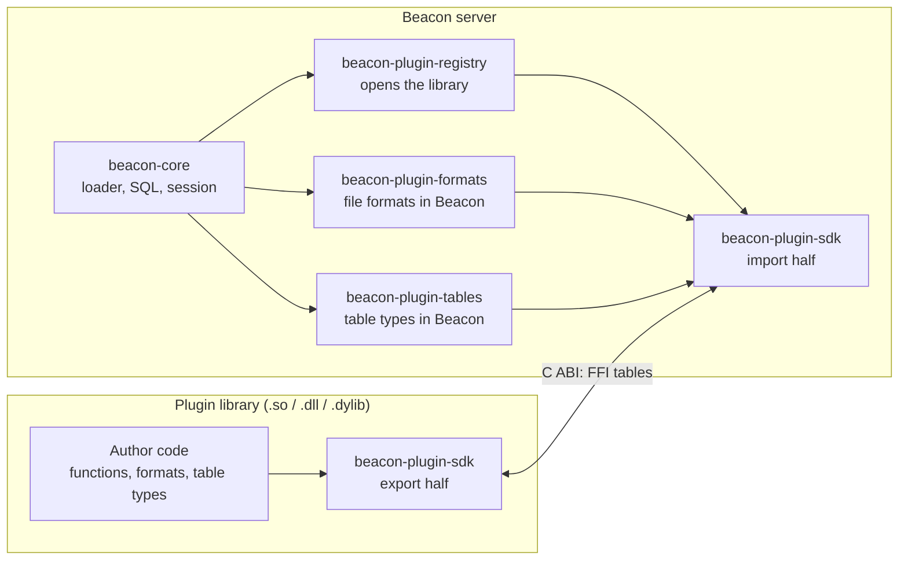

| Crate | Side | Task |
| --- | --- | --- |
| `beacon-plugin-sdk` | both | traits, FFI tables, the `export_plugin!` macro |
| `beacon-plugin-registry` | Beacon | opens the library, checks the ABI, reads the symbols |
| `beacon-plugin-formats` | Beacon | makes a DataFusion file format from a plugin format |
| `beacon-plugin-tables` | Beacon | makes a table from a plugin table type, and is the host of table code |
| `beacon-core` | Beacon | `INSTALL`, `UNINSTALL`, the loader, the session |

## What a plugin exports

`export_plugin!` generates up to four `extern "C"` symbols. A plugin exports one part or more.

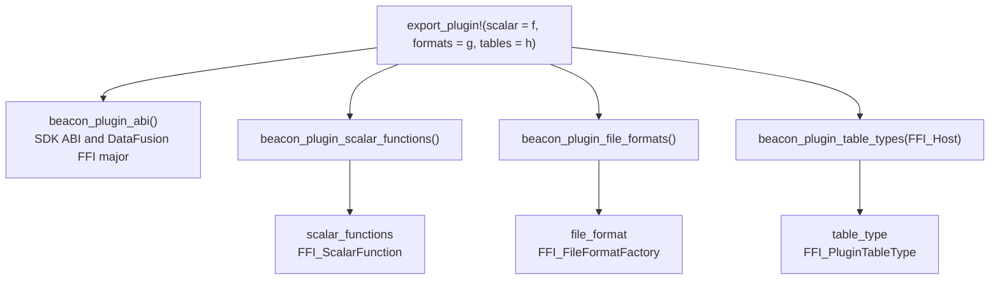

Only the table types symbol takes an argument: the host. See [The host](#the-host).

## Load sequence

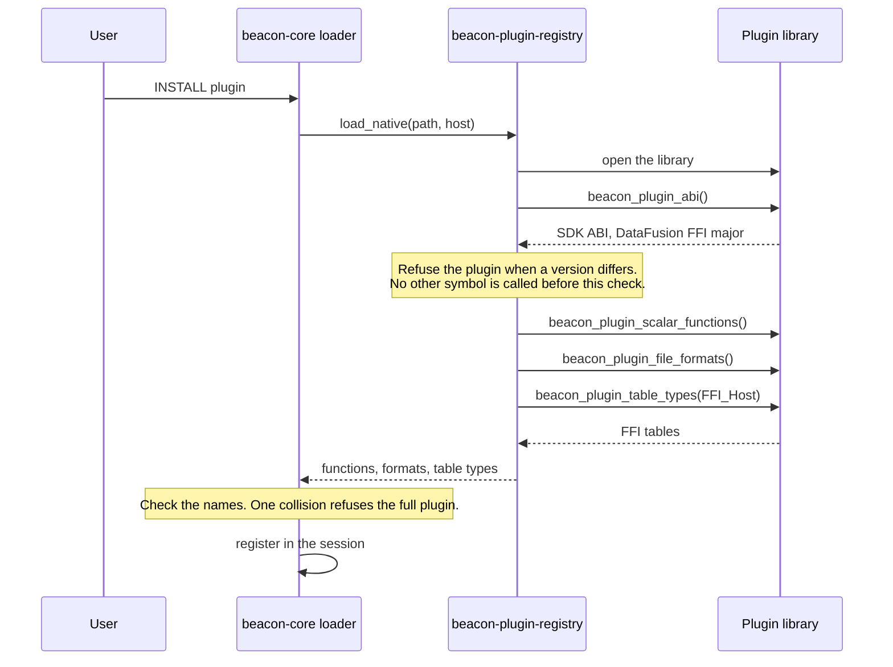

A library that opens stays loaded until the process stops. Plugin code can still run after `UNINSTALL`, because plans and streams hold pointers into the library.

## Modules

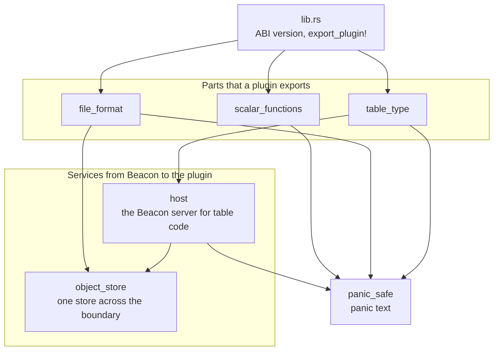

| Module | Direction | Content |
| --- | --- | --- |
| `scalar_functions` | plugin to Beacon | the function builder, planner hooks, scalar arguments |
| `file_format` | plugin to Beacon | `FormatFactory` and `FormatReader`, with their FFI tables |
| `table_type` | plugin to Beacon | `TableType`, the plugin runtime, the session wrapper |
| `object_store` | Beacon to plugin | `FFI_ObjectStore`: one `ObjectStore` across the boundary |
| `host` | Beacon to plugin | `HostApi`, `Host`, `FFI_Host`: the server for table code |
| `panic_safe` | internal | reads the text of a panic |

The SDK also re-exports `datafusion`, `datafusion_ffi`, `datafusion_proto`, `stabby` and the `object_store` crate. A plugin depends only on the SDK, so its versions match the versions in Beacon.

## The pattern of an FFI table

Each trait that crosses the boundary uses the same three parts.

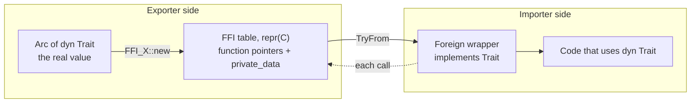

Each table follows these rules:

- **`version` is the first field.** It returns `BEACON_PLUGIN_SDK_ABI`. The importer refuses another version before it reads other fields.
- **`private_data` belongs to the exporter.** Only the exporter reads it. `clone` and `release` manage it.
- **`library_marker_id` identifies the build.** When the importer is the same build, it takes the original value and skips the table. Tests in one binary set another marker to force the foreign path.
- **No panic crosses `extern "C"`.** Each exported function uses `catch_unwind` and returns an error text.
- **Errors cross as text.** The importer makes a DataFusion or object store error from the text.

`BEACON_PLUGIN_SDK_ABI` is one version for all tables. It increases on each change of a table layout.

## Scalar functions

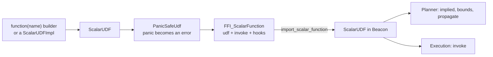

- The function crosses as a `datafusion-ffi` `FFI_ScalarUDF`.
- `invoke` calls the function and keeps each scalar argument as a scalar.
- `FunctionHooks` are optional. They let a filter on the function prune files.

## File formats

A file format has two traits. Beacon does the work for many files; the plugin reads or writes one file in each call.

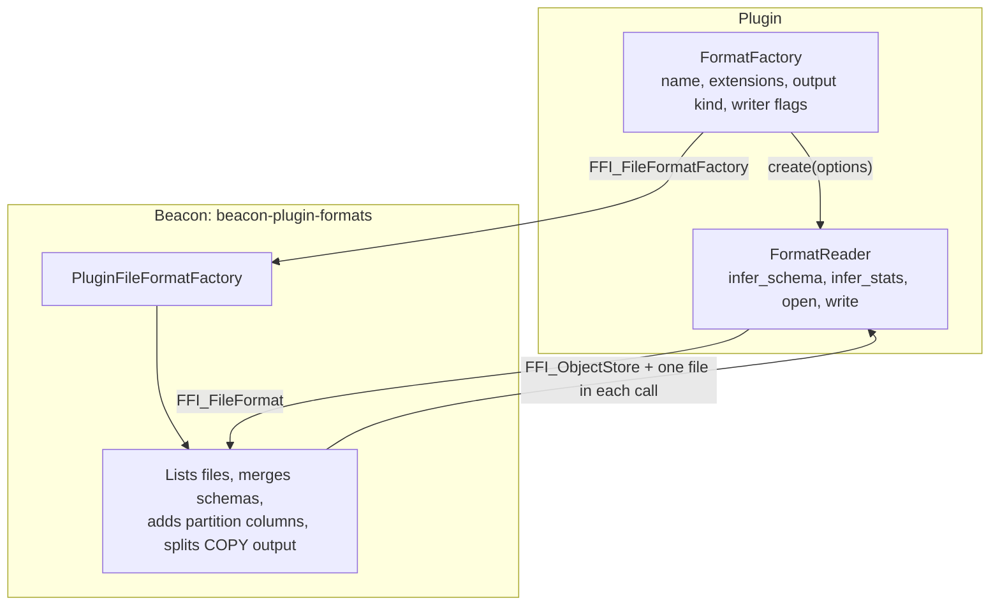

Beacon gives the store to each reader call. A format plugin does all I/O through that store.

## Table types

A table type is a DataFusion `TableProviderFactory` with a `STORED AS` name.
The factory crosses as a `datafusion-ffi` `FFI_TableProviderFactory`. The SDK adds three wrappers around the author code.

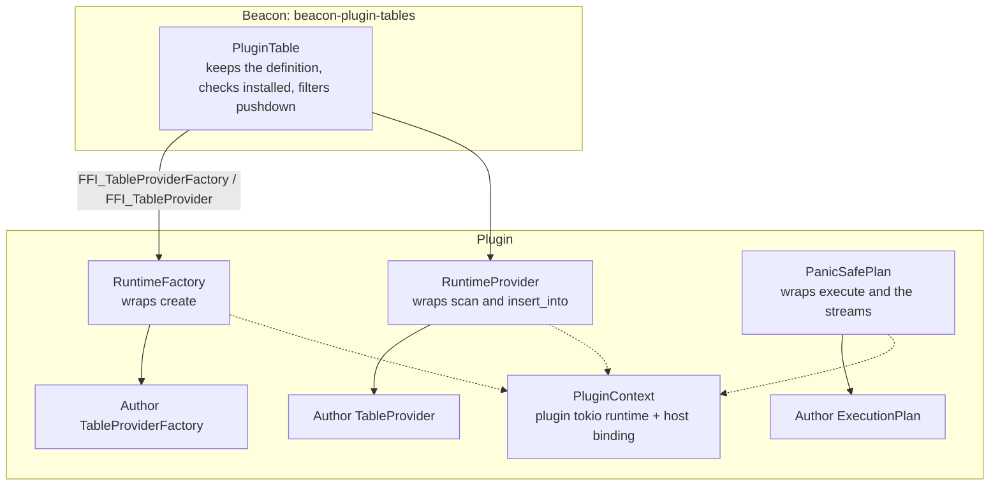

Each wrapper has two tasks:

1. **Enter the plugin runtime.** `datafusion-ffi` 54.1 enters the runtime of a table only for record batch streams. The wrappers enter it for each poll of `create`, `scan` and `insert_into`.
2. **Catch panics.** `datafusion-ffi` catches none. A panic becomes a query error.

One `PluginContext` exists for each export call. Each Beacon instance in a process thus has its own plugin runtime and its own host. The SDK keeps no `static` for this.

## The host

The host is the Beacon server as table code sees it. It has three layers, each in its own file.

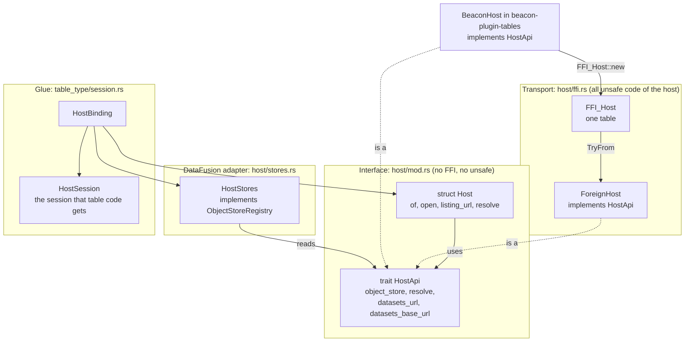

| Layer | Type | Who uses it |
| --- | --- | --- |
| Interface | `HostApi` | Beacon implements it. A plugin test can implement it. |
| Interface | `Host` | plugin table code |
| Transport | `FFI_Host`, `ForeignHost` | the SDK only |
| Adapter | `HostStores` | DataFusion code in the plugin, through the session |
| Glue | `HostBinding`, `HostSession` | the SDK only |

### What the host gives

- **Object stores.** `object_store(url)` returns the Beacon store for a scheme and authority. It crosses as an `FFI_ObjectStore`. The I/O runs in Beacon, with the credentials of Beacon.
- **The `LOCATION` rule.** `resolve(location)` returns the store URL and the path. Beacon owns the rule, so a change needs no plugin rebuild.
- **The datasets store.** `datasets_url()` and `datasets_base_url()`.

The table has no function that changes the host. `HostStores` keeps a store that the plugin registers in the plugin only.

### How table code reaches the host

Table code has two paths to the same stores.

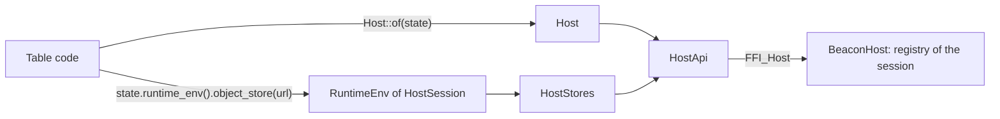

- **`Host::of(state)`** is the direct path. `HostSession::as_any` returns the `Host`, because a borrowed session cannot be an `Any`.
- **`runtime_env()`** is the path for DataFusion code, such as a `ListingTable`. `HostSession` returns an environment whose registry is `HostStores`. The task context of `execute` gets the same registry.

### A read from the datasets store

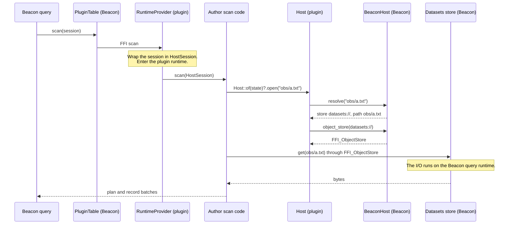

No lookup result is cached in the plugin. A store that Beacon adds or replaces is visible at the next call.

## Runtimes and threads

Three tokio runtimes can take part in one plugin table query.

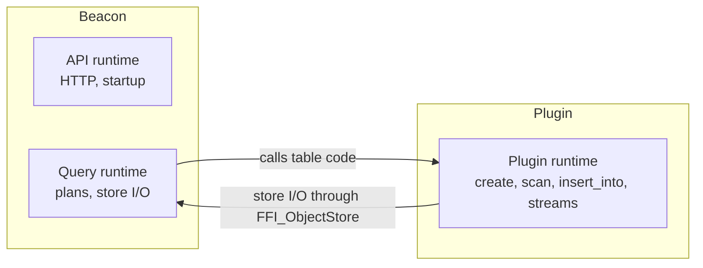

- The plugin has its own tokio copy. The Beacon runtime cannot drive plugin I/O, so the SDK starts a plugin runtime for each export call.
- An author can give a runtime with `TableType::with_runtime`. The SDK then starts none for that type.
- An exported store or host enters the Beacon query runtime for each call. The loader passes that handle, not the handle of the thread that loads the plugin.

## Rules that hold in all modules

| Rule | Reason |
| --- | --- |
| `panic = "unwind"` is necessary. The SDK refuses `abort` at compile time. | A panic must become an error, not stop the server. |
| No panic crosses `extern "C"`. | An unwind across the boundary is undefined behavior. |
| The plugin and Beacon must have the same SDK ABI and DataFusion FFI major. | The table layouts must match. |
| No state of one server in a `static`. | Several Beacon instances can share one process and one library. |
| The traits have no FFI types in their signatures. | An author implements a trait and never writes FFI code. |

## Where to put new code

- **A new service from Beacon to table code:** add a method to `HostApi`, a function to `FFI_Host`, and the implementation to `BeaconHost`. Increase `BEACON_PLUGIN_SDK_ABI`.
- **A new kind of plugin part:** add a module with its trait, its FFI table and its foreign wrapper. Add a key to `export_plugin!` and a symbol to `beacon-plugin-registry`.
- **A change of a table layout:** increase `BEACON_PLUGIN_SDK_ABI`. Each native plugin then needs a rebuild.

The `host` module separates the interface from the transport. The older `file_format` and `object_store` modules keep both in one module.
